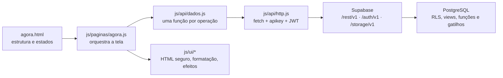

# Arquitetura

O Vale Sair? é um app estático: HTML, CSS e JavaScript puro, sem framework e sem etapa de build. Cada tela é uma página, e cada página tem um módulo JavaScript que busca os dados na API REST do Supabase.

## O caminho de uma tela

Nada de regra de negócio no front: quem decide o que cada pessoa pode ver e fazer é o banco. O JavaScript monta a tela e traduz erros.

## Pastas

| Pasta | Papel |
| --- | --- |
| `public/js/api/` | `sessao.js` (JWT no navegador), `http.js` (cliente REST), `auth.js` (entrar, cadastrar, recuperar senha), `dados.js` (operações do app) |
| `public/js/ui/` | `dom.js` (HTML seguro), `formatos.js` (funções puras), `componentes.js` (pedaços reaproveitados), `enquete.js`, `feedback.js` (avisos e efeitos), `shell.js` (menu, barra e painéis) |
| `public/js/paginas/` | um módulo por tela, que só orquestra |
| `public/css/` | `tokens` → `base` → `layout` → `componentes` → `telas` → `movimento` |

## Telas

| Tela | Página | Principais chamadas |
| --- | --- | --- |
| Abertura | `index.html` | — |
| Entrar / Criar conta | `login.html`, `cadastro.html` | `/auth/v1/token`, `/auth/v1/signup`, RPC `username_disponivel` |
| Agora | `agora.html` | view `locais_status` |
| Radar | `radar.html` | `locais_status` + RPC `amigos_por_perto` |
| Lugar | `local.html?id=` | `locais_status`, `pulsos_feed`, `mensagens_sala`, `checkins`, `locais_salvos` |
| Ao vivo | `aovivo.html?local=` `?cena=` | `pulsos_feed`, RPC `pulsos_da_cena` |
| Novo Pulso | `pulso.html` | Storage + `pulsos` |
| Criar | `chama.html` | RPC `quero_sair` |
| Novo Chama | `chama-lugares.html` | `turmas_resumo` + RPC `criar_chama` |
| Enquete | `enquete.html?codigo=` | RPCs `chama_publica` e `votar_no_chama` |
| Votação pública | `c.html?codigo=` | as mesmas RPCs, **sem login** |
| Comunidades | `comunidades.html` | `turmas_resumo`, `cenas_resumo`, `salas_ativas` |
| Turma | `turma.html?id=` | `turmas_resumo`, `turma_membros`, `chamas` |
| Cena | `cena.html?slug=` | `cenas_resumo` + RPC `ranking_da_cena` |
| Salvos | `salvos.html` | `locais_salvos` + `locais_status` |
| Perfil | `perfil.html` | RPC `meu_resumo`, `profiles` |
| Meu mês | `retrospectiva.html` | RPC `minha_retrospectiva` |
| Avisos | `notificacoes.html` | `notificacoes` |
| Privacidade | `configuracoes.html` | `preferencias` |

## Sessão e autenticação

1. `login.html` chama `/auth/v1/token?grant_type=password` e guarda a sessão em `localStorage`.
2. Cada requisição leva `apikey` (publishable key) e, com login, `Authorization: Bearer <JWT>`. É do JWT que o banco tira o `auth.uid()` usado em todas as políticas.
3. Perto de expirar, o token é renovado com o `refresh_token`; renovações simultâneas compartilham a mesma promessa.
4. Toda página interna começa com `exigirLogin()`. Um erro 401 em qualquer chamada limpa a sessão e volta para o login.
5. Links de confirmação de e-mail e de nova senha voltam para `login.html` com a sessão no fragmento da URL, que é lida e trocada pela sessão salva.

## Segurança no front

- **Nada de `innerHTML` com dado cru.** Todo HTML é montado com o template `html\`\``, que escapa cada interpolação; só passa direto o que for marcado como seguro (ícones e atributos escritos no código). Há teste para isso, e o E2E confirma no chat real.
- **Links de fora passam por `urlSegura()`**, que só aceita `http(s)`.
- **Redirecionos passam por `destinoSeguro()`**, que só aceita páginas do próprio app — nada de `?next=https://site-falso`.
- A publishable key é pública de propósito: sozinha, ela não abre nenhum dado protegido por RLS.

## Mapa do Radar

| Arquivo | Papel |
| --- | --- |
| `js/ui/mapa.js` | carrega o Google Maps sob demanda, aplica o estilo, cria marcadores e Street View |
| `js/paginas/radar.js` | desenha lugares e pessoas e trata os filtros |
| `js/paginas/local.js` | abre o panorama do Street View mais próximo de cada lugar |

Três decisões:

1. **O mapa preserva os lugares do Google.** Os POIs comerciais ficam visíveis e clicáveis; as poucas regras de estilo aproximam as cores da identidade do Vale Sair sem removê-los.
2. **Os marcadores são HTML nosso.** `mapa.js` posiciona os mesmos pinos e bolhas usados nos outros componentes com `OverlayView`, com âncoras cobertas por testes (`tests/mapa-google.test.mjs`).
3. **Carregamento sob demanda.** A Maps JavaScript API só é baixada no Radar ou ao abrir Street View. Se ela falhar, o Radar continua no mapa ilustrado.
4. **Chave pública, porém restrita.** Como toda chave de navegador, ela aparece no código entregue à pessoa usuária. A proteção vem das restrições de domínio e de API configuradas no Google Cloud, além das cotas de uso.

A localização de quem usa o app é lida no navegador e **nunca vai para o servidor**: serve para o marcador "VOCÊ", para centralizar o mapa e para calcular distância na tela.

## Tempo real

O app pergunta em vez de manter conexão aberta: a Sala busca mensagens novas a cada 5 segundos (só com a aba visível) e as enquetes atualizam o placar a cada 8. É simples, sobrevive a quedas de rede e usa a mesma API REST do resto. Se o volume crescer, o caminho natural é trocar esse trecho pelo Realtime do Supabase, sem mexer no resto da tela.

## Acessibilidade e movimento

Navegação por links de verdade (`<a href>`), estados em `aria-pressed`/`aria-checked`/`aria-current`, diálogos com `<dialog>` nativo (foco preso e Esc), foco visível e rótulos em todos os campos. Quem tem "reduzir movimento" ligado no sistema — ou na tela de privacidade — não vê animação nenhuma: a preferência é aplicada antes da primeira pintura por `js/boot.js`.
