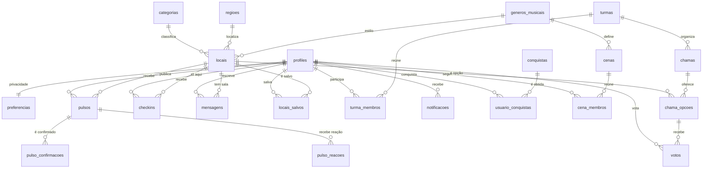

# Banco de dados

PostgreSQL no Supabase. Toda a estrutura está em `supabase/migrations/`, aplicada em ordem pelo nome do arquivo.

| Migration | O que faz |
| --- | --- |
| `..._estrutura.sql` | tipos, 22 tabelas, chaves e índices |
| `..._regras_de_negocio.sql` | funções, gatilhos e as RPCs que o app chama |
| `..._views.sql` | views de leitura usadas pelas telas |
| `..._seguranca.sql` | RLS, políticas e privilégios por coluna |
| `..._storage.sql` | buckets de mídia e suas políticas |
| `..._dados_referencia.sql` | catálogos (regiões, categorias, gêneros, conquistas, cenas) |

## Modelo

`profiles` tem uma linha para cada conta em `auth.users` (o gatilho `criar_perfil_novo_usuario` cria perfil e preferências no cadastro).

### Decisões que valem explicar

- **Pulso expira.** `pulsos.expira_em` nasce com `now() + 2 horas`. A informação "o lugar está cheio" não pode envelhecer em silêncio, e foi uma das dúvidas levantadas na Matriz CSD ("quanto tempo uma atualização continua válida?").
- **Confiança é calculada, não digitada.** A view `locais_status` cruza Pulsos ativos e confirmações e devolve `alta`, `media` ou `baixa`.
- **Voto sem conta.** `votos` aceita `usuario_id` **ou** `convidado_id` (um identificador gerado no navegador), nunca os dois — uma restrição `check` garante isso. A chave estrangeira composta `(opcao_id, chama_id)` impede votar numa opção de outro Chama.
- **Nível vem do XP.** `profiles.nivel` é coluna gerada: `1 + raiz(xp/100)`.
- **Privacidade em duas chaves.** `mostrar_estou_aqui` revela o lugar do check-in; `mostrar_regiao` revela só o bairro. Sem nenhuma das duas, a pessoa não aparece no radar dos amigos.

## Views

| View | Para que serve |
| --- | --- |
| `locais_status` | lugar + movimento, fila, gênero, confiança e quantas pessoas estão lá |
| `pulsos_feed` | Pulso + autor, contadores e se **você** já confirmou ou reagiu |
| `mensagens_sala` | mensagens com autor e selo "oficial" do gestor do lugar |
| `turmas_resumo` | Turma + nº de membros, quantos querem sair e o Chama aberto |
| `cenas_resumo` | Cena + participantes e se você participa |
| `salas_ativas` | lugares ordenáveis por conversa recente |

Todas usam `security_invoker = true`: rodam com as permissões de quem consulta, então o RLS continua valendo.

## Funções expostas na API (`/rest/v1/rpc/...`)

| Função | Quem pode chamar | O que faz |
| --- | --- | --- |
| `username_disponivel` | visitante | confere se um usuário está livre no cadastro |
| `chama_publica` | visitante | lê um Chama pelo código do link |
| `votar_no_chama` | visitante | registra ou troca o voto (conta ou convidado) |
| `criar_chama` | logado | valida de 2 a 4 lugares, cria a enquete e avisa a Turma |
| `entrar_na_turma` | logado | entra por código de convite |
| `quero_sair` | logado | liga/desliga o status e avisa as Turmas |
| `amigos_por_perto` | logado | radar social respeitando a privacidade de cada pessoa |
| `meu_resumo`, `minha_retrospectiva` | logado | números do perfil e do mês |
| `ranking_da_cena`, `pulsos_da_cena` | logado | ranking agregado e feed da Cena |

As funções internas (`conceder_xp`, `conceder_conquista`, `verificar_explorador`) e os gatilhos **não** são executáveis pela API: `revoke execute on all functions ... from public, anon, authenticated` fecha tudo, e só os endpoints acima recebem permissão de volta.

## Gatilhos

| Quando | O que acontece |
| --- | --- |
| nova conta | cria perfil e preferências, resolvendo nome e usuário repetido |
| novo Pulso | +10 XP (ou +20 com mídia), conquistas, aviso para quem salvou o lugar e **antispam de 10 minutos** por lugar |
| confirmação | +5 XP para o autor, +2 para quem confirmou, conquistas e aviso |
| check-in | expira o check-in anterior, dá XP no máximo a cada 30 minutos |
| mensagem | antiflood de 5 mensagens a cada 20 segundos |
| nova Turma | quem criou entra como admin |

## Segurança

Três camadas, todas na migration `..._seguranca.sql`:

1. **RLS ligado nas 22 tabelas.** Cada linha só aparece para quem tem direito: preferências, check-ins, salvos e notificações são privados; Turmas e Chamas só para membros; Pulsos ativos para quem está logado.
2. **Privilégios por coluna.** Mesmo na própria linha, a API só escreve no que faz sentido. `grant update (nome, username, bio, avatar_url, regiao_id) on profiles` — ou seja, **ninguém edita o próprio XP**. Autoria (`autor_id`, `usuario_id`, `criador_id`) tem `default auth.uid()`, então o front nunca informa quem é.
3. **Funções fechadas por padrão**, como descrito acima.

Visitante sem conta enxerga apenas catálogos e lugares; o resto passa pelas RPCs públicas.

### Avisos do linter do Supabase

O advisor de segurança aponta as funções `SECURITY DEFINER` que a API pode executar. São **intencionais**: `chama_publica` e `votar_no_chama` existem justamente para o link de votação funcionar sem conta, e `username_disponivel` para o cadastro. As demais são as RPCs do app, liberadas só para quem está logado. O advisor de performance lista "índice não usado", esperado num banco ainda sem tráfego.

## Testes

`npm test` aplica as migrations reais num PostgreSQL em memória (PGlite) com uma réplica mínima do ambiente Supabase (`tests/banco/supabase-stub.sql`) e verifica, simulando pessoas logadas e visitantes:

- RLS ligado em todas as tabelas e catálogos visíveis para visitantes
- ninguém edita o próprio XP nem o perfil alheio
- autoria não pode ser forjada e ninguém confirma o próprio Pulso
- antispam de Pulsos e antiflood de mensagens
- Turma fechada para quem não é membro e entrada por convite
- Chama com 2 a 4 lugares, aviso para a Turma e voto por link sem conta (trocar de ideia não duplica)
- radar respeitando as três combinações de privacidade
- Storage: cada pessoa só escreve na própria pasta
- funções internas inacessíveis pela API
